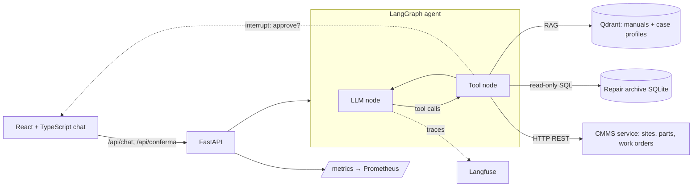

# AI maintenance assistant — LangGraph agent + RAG + CMMS integration

An agentic assistant for the repair lab of **KYROS ACCESS**, a fictitious manufacturer of access-control devices
(electric locks, electronic cylinders, control units, badge readers, keypads). Technicians ask in Italian; the agent
searches the service manuals (RAG), looks up similar past repairs, queries the repair archive with SQL and works
with the **CMMS** (maintenance management system): installed sites, spare-parts stock, work orders.
Any write to the CMMS stops and waits for **human approval**.

It is the production-oriented follow-up of
[document-ai-schede-riparazione](https://github.com/massimiliano-cantore/document-ai-schede-riparazione):
same synthetic company and archive (~7,400 repairs), from digitized repair sheets to an assistant that uses them.

> All data is synthetic. No real company, customer or document is included.

## What it shows

| Area | How |
|---|---|
| Agentic framework | **LangGraph** `StateGraph` (model ⇄ tools loop), per-thread **checkpointer** for multi-turn chats, `interrupt` for **human-in-the-loop** approval |
| Tools & system integration | 6 tools: manuals (RAG), similar cases (RAG), read-only SQL, and 3 **CMMS REST API** calls over HTTP (FastAPI service) |
| RAG | Section-level chunking of manuals, **Qdrant** vector store (server, on-disk or in-memory), metadata filtering by product family, multilingual dense embeddings (FastEmbed/ONNX), citations of the sources |
| Quality | Unit/integration tests with a **scripted LLM** (deterministic, no key), retrieval evaluation (hit@k, MRR) on every push, end-to-end agent evaluation with the real model (weekly / on demand), thresholds that fail the pipeline |
| Versioning | Prompt and model configuration versioned in `config/agente.yaml` + `prompts/`; every evaluation report records config + git commit |
| Observability | Prometheus metrics (latency, tool calls/errors, tokens, approvals), structured JSON logs, optional **Langfuse** tracing |
| Delivery | **Docker** multi-stage (index and embedding model baked at build time), `docker compose` stack, **GitHub Actions** CI/CD, **Google Cloud Run** deploy workflow, **Kubernetes** manifests |
| Frontend | **TypeScript + React** chat: shows every agent step and the approval card for CMMS actions |

## Architecture



The LLM is any OpenAI-compatible endpoint (default: Groq free tier), with fallback models if the first is unavailable.

## Run it

**In the browser, nothing to install (GitHub Codespaces):** add `GROQ_API_KEY` under
*GitHub → Settings → Codespaces → Secrets* (free key at console.groq.com), then on this repo
*Code → Codespaces → Create codespace*. When the setup finishes, run `./avvia.sh` in the terminal and open port 8000.

**On your computer** (Python 3.11+, Node 22, Git):

```bash
git clone https://github.com/massimiliano-cantore/assistente-manutenzione-ai
cd assistente-manutenzione-ai
python -m venv .venv && source .venv/bin/activate      # Windows: .venv\Scripts\activate
pip install -r requirements-dev.txt
cp .env.example .env                                    # then put your GROQ_API_KEY in .env
./avvia.sh                                              # Windows: see GUIDA.md
```

Tests and evaluations: `pytest -q` (no key needed) · `python -m valutazioni.valuta_rag` · `python -m valutazioni.valuta_agente`.

Full stack with Docker (Qdrant server, CMMS as a separate service, Prometheus): `docker compose up --build`.

## Evaluation

| What | Metric | Result |
|---|---|---|
| Retrieval, 26 technician-style questions (paraphrased, not copied from titles) | hit@4 / MRR | TF-IDF baseline **0.81 / 0.73**; dense multilingual MiniLM **0.85 / 0.74** |
| Agent end-to-end, 12 cases (numbers from SQL, procedures, CMMS stock, approval requested) | correct answers | prompt v1: 10/12 and 9/12 · prompt v2: **12/12** (Groq, `openai/gpt-oss-120b`) |

How v1 became v2, driven by the evaluation logs: a tool returned an empty list that Groq rejects (fixed in code,
regression test added); the model searched a plant id as a serial number (tool now accepts the id, prompt states the
code formats); the model skipped similar cases for a fault (prompt now requires both sources); one "wrong" answer was
actually right but used a typographic hyphen (evaluator fixed). With 12 cases and a non-deterministic model a single
run is indicative: the weekly run tracks stability.

Each run writes a JSON report with the configuration (model, prompt version, embedder) and the git commit,
so results stay comparable across prompt and model changes.

## CI/CD

- **CI** (every push): ruff, pytest, retrieval evaluation (fast TF-IDF + production embedding model),
  TypeScript typecheck/tests/build, Docker build and a smoke test of the whole stack.
- **Valutazione agente** (weekly / manual): end-to-end evaluation with the real model; fails under threshold.
- **Deploy su Google Cloud Run** (manual or on `v*` tags): builds, pushes to Artifact Registry, deploys both services.
  One-time setup in [`deploy/cloud-run.md`](deploy/cloud-run.md). Kubernetes manifests in [`deploy/k8s`](deploy/k8s).

## Limits (on purpose, for a demo)

- Conversations live in an in-memory checkpointer → one replica. In production: a database checkpointer (e.g. Postgres) and horizontal scaling.
- The demo CMMS is public and has no authentication; a real integration would use service-to-service auth.
- Synthetic notes are drawn at random, so "similar cases" statistics show the mechanism, not real failure patterns.
  On real data the same pipeline would surface real correlations.

## Project layout

```
app/agente/      LangGraph graph, tools (with interrupt), service layer
app/rag/         embedders (FastEmbed / TF-IDF), Qdrant knowledge base
app/cmms/        CMMS store, REST API, HTTP client
app/api.py       FastAPI: chat, approval, health, metrics, static UI
prompts/ config/ versioned prompt and configuration
dati/            synthetic repair archive + service manuals (Markdown)
valutazioni/     retrieval and agent evaluations
tests/           pytest with a scripted LLM
frontend/        React + TypeScript
docker/ deploy/ .github/workflows/
```
